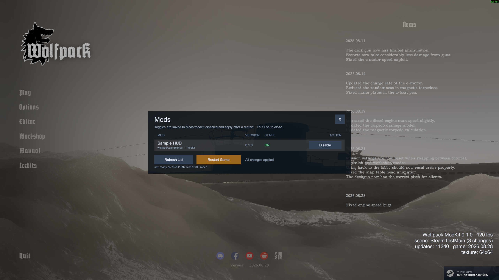
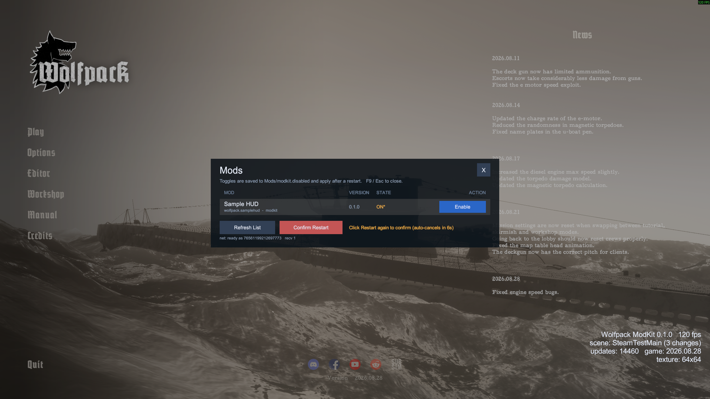
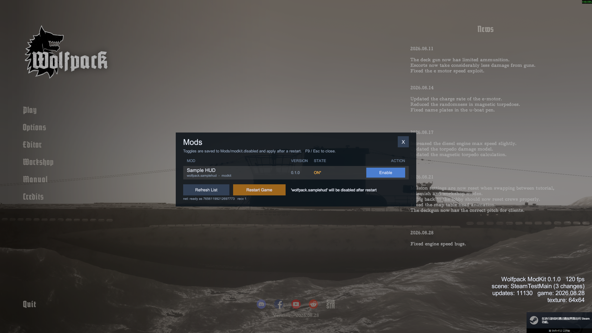

# P5 验证记录 —— 主菜单 Mod 启停面板

| 项 | 内容 |
|---|---|
| 日期 | 2026-11-17 |
| 目标 | 在基础 Mod 框架上增加可视化启停入口：单 Mod 启用/关闭按钮、列表刷新、手动重启；界面只在主菜单出现 |
| 结论 | **全部通过**。主菜单右上角出现 `MODS` 入口；关闭 Mod 立即写入 `Mods/modkit.disabled`；`Refresh List` 重扫目录；`Restart Game` 二次确认后热重启，重启后被禁用的 Mod 不再加载；离开主菜单后界面自动销毁 |
| 运行结果 | 0 错误 0 警告，`BepInEx/ErrorLog.log` 为空；主菜单稳定 120 fps |
| 版本 | Wolfpack ModKit **0.2.0** |

> 本记录是基础框架（P1–P4）之后的增量。报告第 8 节里的“P5 工具链与发布”尚未开始，两者同名不同内容。

---

## 1. 交付内容

| 文件 | 变更 |
|---|---|
| `src/WolfpackModKit/ModsPanel.cs` | **重写**：主菜单 Mod 管理面板（入口按钮、列表、启停、刷新、重启、滚动、状态文案） |
| `src/WolfpackModKit/GameRestart.cs` | **新增**：安全重启（等待本进程退出后经 Steam 协议重新拉起） |
| `src/WolfpackModKit/ModLoader.cs` | 新增 `Rescan / SetEnabled / IsLoaded / IsActive / IsDisabledOnDisk / DisabledCount` 等状态接口；失败信息归档；重复 Id 去重 |
| `src/WolfpackModKit/ModKitPlugin.cs` | 版本 0.2.0；场景钩子里通知面板切换场景 |
| `src/WolfpackModKit/Hud.cs` | `GetFont()` 改为内部可见，面板与 HUD 共用同一字体 |
| `src/samples/SampleHud/SamplePlugin.cs` | HUD 版本号同步为 0.2.0 |

面板完全走 uGUI + 手动点击命中（原因见第 6 节），没有注入 MonoBehaviour，也没有使用 `Button.onClick` 委托。

---

## 2. 交互设计

### 2.1 入口

- 只在主菜单场景 **`SteamTestMain`** 创建：右上角 `MODS` 按钮（128×46，离边 28）。
- 进入 `Boot` / `Setup` / 对局场景时，整块 Canvas 被销毁，日志记录 `mod manager hidden`。
- `F9` 打开/关闭；`Esc` 关闭；面板右上角 `X` 关闭。
- 面板打开时铺一层 55% 黑色遮罩，并用 `GraphicRaycaster` 把点击挡在游戏原生 UI 之外。



### 2.2 面板内容

- 每行：显示名、ModId + 作者、版本、状态、动作按钮（`Disable` / `Enable`）。
- 底部：`Refresh List`、`Restart Game`、状态提示、网络握手状态（`net: ... recv N`）。
- 行数超过 7 时列表区可滚动（`RectMask2D` + 滚轮），列表数据每次操作后整块重建。

### 2.3 状态语义

| 状态 | 含义 | 是否待重启 |
|---|---|---|
| `ON` | 当前会话已加载，磁盘也是启用 | 否 |
| `ON*` | 当前会话还开着，但磁盘已关闭 | 是（重启后关闭） |
| `OFF` | 当前会话没加载，磁盘也是关闭 | 否 |
| `OFF*` | 磁盘已重新启用，但本次会话没加载 | 是（重启后加载） |
| `NEW` | 运行中新增的目录（刷新时发现） | 是（重启后加载） |
| `FAILED` | 加载失败 / 连续异常被隔离 | — |
| `NOT LOADED` | 启用但没有加载记录（如依赖缺失） | — |

底部提示会汇总：`N change(s) pending - restart to apply`；有改动时右上角入口显示 `MODS (N)`。

### 2.4 手动重启（二次确认）

- 第一次点 `Restart Game`：按钮变红为 `Confirm Restart`，提示“再点一次确认（6 秒后自动取消）”。
- 6 秒内再点：调用 `GameRestart.TryRestart()`，退出游戏并在进程结束后经 Steam 重新启动。
- 单选或误触不会直接重启。



---

## 3. 数据落盘与刷新

`Mods/modkit.disabled`：一行一个 ModId，`#` 开头为注释；没有该文件表示全部启用。

- `SetEnabled` 只改磁盘状态，**不会在运行时卸载程序集**；界面用 `ON*` / `OFF*` 明示“重启后生效”。
- 写入采用 `modkit.disabled.tmp` + `File.Move(..., overwrite: true)`，避免游戏崩溃时留下半个文件。
- `Refresh List` 调用 `ModLoader.Rescan()`：重新读取所有 `Mods/*/manifest.json` **和** `modkit.disabled`。
  - 手动在资源管理器里改 `modkit.disabled`、或新拷入一个 Mod 目录，点刷新即可看到，无需重启游戏。
  - 刷新只更新列表，不会在运行中加载新 Mod；`NEW` 状态提示需重启。

---

## 4. 重启实现

`GameRestart.TryRestart()` 不直接 `Process.Start` 游戏 exe，而是：

1. 启动一个隐藏的 `powershell.exe`：
   `Wait-Process -Id <当前PID> -Timeout 60; Start-Sleep 2; Start-Process 'steam://rungameid/490920'`
2. 调用 `ModLoader.Shutdown()` 与 `Application.Quit()`。
3. 旧进程退出后，脚本再让 Steam 拉起游戏；Steam URL 失败时回退为直接启动 `Wolfpack.exe`。

**为什么要等进程退出**：游戏还活着时打开 `steam://rungameid/...`，Steam 只会聚焦已有实例，不会启动新实例；等退出后再拉起才是真正的“重启”。

---

## 5. 验证结果

### 5.1 场景门控

```
[mods] scene 'Boot' - mod manager hidden
[mods] scene 'Setup' - mod manager hidden
[mods] main-menu UI created
[mods] main menu detected ('SteamTestMain') - mod manager available
```

离开主菜单的 `hidden` 与进入主菜单的创建都只发生一次（启动阶段已去重）。

### 5.2 启停写盘

点击 `Disable` 后：

```
[mods] 'wolfpack.samplehud' -> disabled on disk; 1 change(s) pending restart
```

`Mods/modkit.disabled` 内容为 `wolfpack.samplehud`；面板状态变 `ON*`（橙色），按钮变 `Enable`，底部提示 1 项待重启。



### 5.3 刷新

```
[mods] list refreshed: 1 mod(s), 1 disabled
```

刷新会重新读取磁盘上的 `modkit.disabled`，因此外部手工修改也能被识别。

### 5.4 重启与持久化

二次确认后旧进程退出，新进程 PID 变化（测试中 36156 → 36104），新会话日志：

```
[kit] 0/1 mods active (1 disabled on disk)
[mods] main menu detected ('SteamTestMain') - mod manager available
```

且新会话**没有任何** `[wolfpack.samplehud]` 日志 —— 被禁用的 Mod 确实没有加载。面板此时显示 `OFF` + `Enable`。

### 5.5 最终构建冒烟

移除调试日志后用最终 DLL 再启动一次：

```
[kit] 1/1 mods active (0 disabled on disk)
[mods] scene 'Boot' - mod manager hidden
[mods] scene 'Setup' - mod manager hidden
[mods] main-menu UI created
[mods] main menu detected ('SteamTestMain') - mod manager available
```

`ErrorLog.log` 为空，构建 0 警告 0 错误。

---

## 6. 踩坑与修复

| # | 现象 | 根因 | 修复 |
|---|---|---|---|
| 1 | 点 `Disable` 反而把 Mod 重新启用（日志 `-> enabled on disk`） | 行按钮闭包传入的是**当前** `enabled`，而不是目标值 | 改为 `ToggleMod(id, !enabled)`；这次是真实点击测试才暴露的 |
| 2 | 网络状态行压在 `Refresh/Restart` 按钮上 | `net` 标签 y 只下移 20，仍在 36 高的按钮区 | 下移到按钮下方并加大面板高度 |
| 3 | 点击 X 无反应 | 测试时游戏窗口被 Chrome/控制台遮挡，点击落在别的窗口 | 用 `SetForegroundWindow + AttachThreadInput` 真正确认前台是本进程再点；不是产品 bug |
| 4 | 确认重启后几秒内进程还在 | `Application.Quit()` 在 Unity 关帧/释放资源时不是同步退出 | 以“新 PID + 新会话日志”作为重启成功的判据 |
| 5 | 重启后看不到 `[restart]` 日志 | 新会话启动时 `LogOutput.log` 被截断重写 | 同上，用新会话内容验证结果 |
| 6 | 面板点击不想走 `Button.onClick` | IL2CPP + Il2CppInterop 下 UnityAction 委托编组是高风险区；本作注入 MonoBehaviour 还会崩（P2） | 自己按帧读 `Input`，用 `RectTransformUtility.RectangleContainsScreenPoint` 命中 RectTransform；同时挂 `GraphicRaycaster` 遮罩挡住原生 UI |

---

## 7. 已知限制

1. **中文字形**：内置 Arial 不含 CJK（P3 结论），面板文字全为英文；中文版需要 TMP 字体资产或系统字体裁剪。
2. **运行期不卸载**：Mod 程序集一旦加载就无法卸载，启停必须重启；界面已用 `ON*`/`OFF*` 标注。
3. **Steam AppID 写死**：`GameRestart` 使用 `490920`；非 Steam 环境会回退到直接启动 exe，但 Steam 联机功能可能不可用。
4. **场景名写死**：只认 `SteamTestMain`；游戏改场景名时需同步 `ModsPanel.MainMenuScene`。
5. **长列表滚动**：逻辑已实现（超过 7 行可滚轮、按视口裁剪命中），但本轮只有 1 个示例 Mod，未做 20+ Mod 的实机压力测试。
6. **重启窗口**：二次确认 6 秒后自动取消，避免用户忘记后误触。

---

## 8. 下一轮建议

1. 原生菜单整合：把入口挂到 `W_MainMenu` 的设置/工坊页签，而不是独立叠加层。
2. 字体：内置一套含 CJK 的 TMP 字体，面板/日志/HUD 统一中文。
3. 启停策略：加入依赖检查（禁用被依赖的 Mod 时给出警告）与“全部启用/全部禁用”。
4. 运行期热载：新增 Mod 的 `Assembly.LoadFrom` 可以尝试在刷新时直接加载，但卸载仍无解，收益有限。

---

*本记录对应 `docs/Wolfpack_Mod框架可行性分析报告.md` 第 8 节之后的实现增量。*
